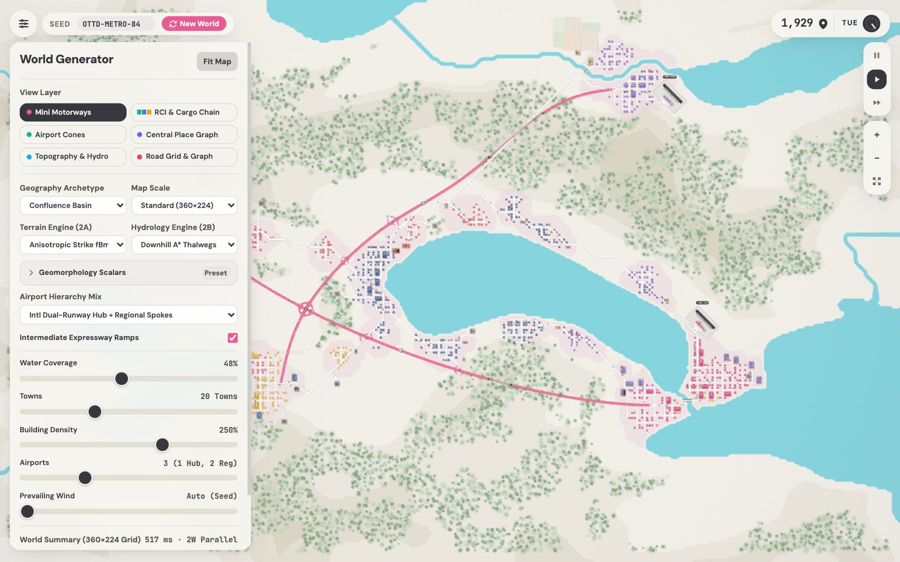

# Mini Logistics

A regional procedural world generator and multimodal transportation logistics simulator inspired by **OpenTTD** (_TerraGenesis_) and **Mini Motorways** / **Mini Metro**.



The project synthesizes a 360×224-tile regional landscape in native browser ES Modules, a 3-thread `OffscreenCanvas` Web Worker pipeline (`main.js` + `world-worker.js` + `render-sim-worker.js`), and retained `Path2D` vector display lists with zero build steps. The synthesized landscape includes emergent tectonic mountain ranges, non-bifurcating river watersheds, central-place urban hierarchies, residential, commercial, and industrial (RCI) zoning, multi-tier airports, grade-separated expressway networks, and an active inter-industrial freight supply chain.

---

## Quick start

Serve the repository root over the static development server so native ES Modules and module Web Workers can load:

```sh
bun run dev
```

Then open `http://127.0.0.1:8788/index.html` in a modern browser.

---

## Verification, Git hooks, and longitudinal benchmarking

The repository runs buildless in the browser. Automated checks enforce static formatting, linting, JSDoc typechecking (`strictNullChecks: true`) against the [shared Hourglass domain schema](./src/types.d.ts#L1-L1368) and [centralized grid & geometry constants](./src/constants.js#L1-L311), algorithmic worldgen invariant tests, static HTML-to-JS DOM contract checks, longitudinal performance benchmarks, and headless Playwright E2E verification:

```sh
# Format check (native Bun formatter)
bun fmt --no-script --check src/ tests/ playwright.config.js index.html

# Lint check
bunx oxlint --deny-warnings src/ tests/

# JSDoc typecheck (native Bun TypeScript checker)
bun check --no-script

# Algorithmic, worldgen invariant, and DOM contract unit tests (zero DOM mocks)
bun test --check tests/unit

# Longitudinal per-stage and end-to-end performance delta benchmark vs baseline
bun run bench --compare benchmarks/baseline.json --markdown

# Headless Chromium E2E tests via Playwright
bunx playwright test

# Run all static checks, unit tests, and Playwright E2E gates
bun run check
```

Running `bun install` configures versioned Git hooks through `"prepare": "git config core.hooksPath .githooks"` in [package.json](./package.json#L11-L24). This enables the [pre-commit formatting, staged lint, and JSDoc typecheck gate](./.githooks/pre-commit#L1-L6) and the [pre-push unit & worldgen invariant gate](./.githooks/pre-push#L1-L4).

---

## Procedural generation pipeline

World synthesis runs off the main thread inside the [world generation Web Worker](./src/world-worker.js#L1-L122). It executes a 9-stage memoized reactive DAG backed by a [3-entry bounded LRU stage combinator](./src/state.js#L86-L135) and orchestrated by the [procedural world pipeline](./src/world-generator.js#L1281-L2141):

1. **Prevailing wind and orographic climate.** Sets a seed-deterministic [prevailing wind vector](./src/world-generator.js#L540-L558) from [shared runway wind axes](./src/constants.js#L145-L168). This vector governs airport runway orientation and [windward/leeward orographic moisture](./src/world-generator.js#L605-L675) across mountain slopes.
2. **Stage 2A: Terrain synthesis and 6-scalar geomorphology basis.** The [terrain heightmap and basin solver](./src/terrain-solvers.js#L16-L838) evaluates a continuous 6-scalar geomorphology basis (`terrainRelief`, `valleyIncision`, `coastalEmbayment`, `calderaCurvature`, `barrierFragmentation`, `basinCount`) defined in [ARCHETYPE_PARAMETER_PRESETS](./src/constants.js#L207-L289) across 9 orthogonal landform archetypes (`confluence`, `inland`, `alpine-passes`, `fjord-sound`, `isthmus-strait`, `caldera-basin`, `barrier-lagoon`, `canyon-gorge`, `island-hopper`) and three live-switchable geomorphology engines behind a shared quantile sea-level calibration waist:
   - **Anisotropic strike fBm and ridged multifractal spines.** Domain-warped gradient noise rotated into a seed-unique geological strike frame with folded valleys and sharp mountain backbones.
   - **Quilez analytic derivative-eroded fBm.** Uses [quintic analytic partial derivatives](./src/math.js#L155-L223) to damp high-frequency octaves on steep gradients. This flattens alluvial plains and sharpens eroded crags in a single pass.
   - **Domain-warped Voronoi tectonic micro-plates.** Models 15 Poisson-spaced crustal plates. Convergent sutures buckle into cordillera ranges, and divergent sutures form rift basins.
   - **Continuous geomorphology basis operators.** The scalar basis controls six terrain properties: `terrainRelief` (20% to 200%) scales cordillera spine amplitude. `valleyIncision` (0% to 200%) drives plateau terracing, mesa cliff steepness, and saddle cols. `coastalEmbayment` (0% to 200%) controls sea slope, opposing isthmus bay pinches, and dendritic fjord troughs (`0%` enforces 100% landlocked terrain on `inland`). `calderaCurvature` (0% to 200%) models radial Somma rings, crater lakes, and resurgent domes (`caldera-basin`). `barrierFragmentation` (0% to 200%) cuts outer barrier island spits, tidal inlets, and lagoon wells (`barrier-lagoon`). `basinCount` (1 to 6) controls interior lake wells and saddle pass density. In the UI, a compact 2-column matrix in [#advancedGeoDetails](./index.html#L75-L165) provides slider tuning, preset delta badges, and instant reset in [src/main.js](./src/main.js#L465-L510).
3. **Stage 2B: Fluvial hydrology.** The [fluvial hydrology solver](./src/hydrology-solvers.js#L24-L1201) carves river channels and alluvial valleys using a shared [flat typed-array binary min-heap](./src/math.js#L233-L328) across three selectable engines:
   - **Basin tree and downhill A\* thalwegs.** Links interior lakes to lower basins through non-bifurcating outflows. Routes map-border and highland-spring rivers down valley thalwegs.
   - **Priority-Flood and D8 Strahler tributary networks.** Fills terrain depressions through a min-heap Priority-Flood pass and traces steepest-descent D8 rivers into converging confluences.
   - **Ikeda floodplain meanders.** Evolves compound sinusoidal S-bends across low-slope alluvial plains while keeping highland gorges tight.
   - **Smoothed-octilinear river and shoreline geometry.** Rivers route along multi-tile octilinear runs (0°, 45°, 90°) between 4.2-tile waypoints in [smoothPolyline](./src/hydrology-solvers.js#L62-L295). Waypoint scoring considers distance and directional alignment to eliminate 1-tile H-V-H-V staircase chatter. Coastlines chain Marching-Squares segments into continuous loops with collapsed 1-cell teeth. River ribbons extrude as closed clockwise polygons with quadratic Bezier corner fillets in [extrudeRibbonToPath2D](./src/canvas-layer-cache.js#L1128-L1260) and [drawTaperingRivers](./src/canvas-layer-cache.js#L1276-L1410). Mainland trunk rivers originate at [map-border valley entries](./src/hydrology-solvers.js#L577-L658), upstream lake outlets, or [wooded interior highland springs](./src/hydrology-solvers.js#L521-L575). Rivers snap off-canvas when approaching within 22 tiles of map boundaries.
4. **Spatial distance and alluvial suitability fields.** Computes an 8-neighbor [Euclidean water-distance transform, slope gradient field, and Connected Landmass labeling](./src/world-generator.js#L560-L730) to guide settlement and road placement.
5. **Central place settlement seeding and multi-tier airport solver.** Seeds a [4-tier Christaller settlement hierarchy](./src/world-generator.js#L770-L950) (Metropolises, Regional Cities, Market Towns, and Rural Hamlets). Places [wind-aligned International Dual-Runway Hubs, Regional Airports, and Cargo Airfields](./src/entities/airport/placement.js#L84-L792) with geometric layouts in [src/entities/airport/layout.js](./src/entities/airport/layout.js#L1-L392), NIMBY noise exclusion rings, and obstacle-free approach funnels. Runway geometry enforces wide-body eligibility (`acceptsWidebody: true` on `HUB` and elongated `CRG` runways versus `false` on `REG`). The solver [solveAndPlaceAirports](./src/entities/airport/placement.js#L84-L792) projects outward [ExternalCorridor](./src/types.d.ts#L118-L127) vectors to map borders and registers multimodal [TradeGateway](./src/types.d.ts#L129-L150) nodes for international air freight import and export.
6. **Organic multi-borough grids and regional A\* road network.** Carves [unphased multi-borough street grids](./src/urban-fabric-solver.js#L806-L1058) with variable `3/4/5`-tile block strides and T-junctions. Links settlements and airport terminal loops through [valley-following A\* arterials and perpendicular bank-to-bank bridges](./src/urban-fabric-solver.js#L274-L635) using pooled [A\* pathfinding scratch buffers](./src/world-generator.js#L128-L164).
7. **Multi-dimension RCI zoning, resource niches, and agricultural estates.** Packs city blocks with [dimensionally varied footprints](./src/urban-fabric-solver.js#L806-L1058). Downtown boulevards concentrate Commercial high-rise rotundas, elongated arterial retail halls (`3×2` / `2×3`), and compact corner markets (`2×1` / `1×2`). Surrounding residential zones contain cottages and townhouses with yard breathing room. Peripheral industrial zones contain extraction silos, [recursive BSP farm estates with contour-clipped crop strips and broken-grid tractor tracks](./src/entities/farm-estate/placement.js#L16-L1341), distinct manufacturing plants, and cross-dock warehouses. Out-of-town extractive lots in [seedOutOfTownResourceNiches](./src/entities/rci-building/placement.js#L25-L404) seed 5 distinct `RAW` niches:
   - `MINE` ($\rightarrow$ `ORE`)
   - `TIMBER` ($\rightarrow$ `WOOD`)
   - `FARM` ($\rightarrow$ `AGRI`)
   - Coastal wharf `FISHERY` ($\rightarrow$ `AGRI`, sited on a dry `2×2` pad with a 1-tile setback and `dW in [1.1, 2.8]`, deep marine cyan `#0e7490`)
   - Peri-urban `CHEM` ($\rightarrow$ `CHEM`, olive-lime `#4d7c0f`)
     In-town industrial zoning in [placeTownCommercialAndIndustrial](./src/entities/rci-building/placement.js#L406-L833) specializes factories into 4 `MFG` archetypes (`STEEL`, `FOOD`, `GOODS`, `TECH`) requiring specific commodity inputs. It configures distribution centers into `LOG` hubs with relative-demand shares. Commercial lots receive distinct [demandedGoods](./src/types.d.ts#L384) distributed per town without replacement first.
8. **Expressways, grade-separated interchanges, mountain tunnels, and right-of-way clearance.** Routes numbered expressways along a [coarse-grid A\* valley corridor smoothed with Chaikin B-splines and resampled to uniform arc-length steps](./src/expressway-solver.js#L810-L1351) (`>= 64` samples, average step `<= 0.95` tiles in [sampleMotorwayCurve](./src/expressway-solver.js#L1370-L1425)). Constructs [resized 4-way Cloverleaf interchanges](./src/expressway-solver.js#L1430-L1865) (`outerDist = 3.65`, `leafSpan = 4.85`), [4-ramp Trumpet spurs](./src/expressway-solver.js#L1870-L1985) (outer slip-ramp, inner semi-directional connector, 270° bell loop, and right outer directional ramp), shared beltway roundabouts, and [compacted octilinear diamond underpasses with flexible world-space slip-ramps](./src/entities/interchange/placement.js#L860-L1500) (`walked = 2.35`, `stepReach ≈ 2.15`, 1.50-tile house corridor clearance in [clearBuildingsAndTreesAlongDiamondRamps](./src/entities/interchange/placement.js#L974-L996)). Generates subterranean mountain tunnel bores in [detectMountainExpresswayTunnels](./src/expressway-solver.js#L2444-L2524), 2-plane coalesced expressway and overpass shadows (`groundShadowUnionPath` + clipped lower-deck overpass shadow), and unified eminent-domain right-of-way clearance.
9. **Reactive road network graph, 5-phase pull supply chain, and woodland biomes.** Derives the [memoized road topology and multi-modal vehicle routing graph](./src/vehicle-routing.js#L149-L954) with geometry-accurate Cloverleaf/Trumpet Bezier ramp chains and topological roundabout portals. Generates paved-road and expressway freight corridors through the **5-phase demand-driven pull supply-chain solver** in [buildIndustrialCargoChain](./src/vehicle-routing.js#L1502-L2389). Populates [orographic windward woodlands and spring headwater groves](./src/urban-fabric-solver.js#L1060-L1224). The supply chain executes:
   - **Step 0: Post-clearance normalization and gateway proxies.** Normalizes surviving post-highway demolition lots and synthesizes virtual gateway proxy destinations (`id = 10000 + entityId`) from [TradeGateway](./src/types.d.ts#L129-L150) nodes.
   - **Step 1: Commercial distinct goods pull and log demand aggregation.** Commercial buildings pull matching goods from regional `LOG` hubs (`LOG->COM`, `#7c3aed`), direct `MFG` factories (`MFG->COM`, `#4f46e5`), or gateway imports (`IMPORT->COM`, `#0d9488`). The solver assigns distinct `demandedGoods` without replacement per town first. It consolidates ~50-65% of retail freight through regional `LOG` hubs and aggregates demand profiles onto `LOG` hubs.
   - **Step 2: Direct inter-CBD shipping.** Links central downtown CBD high-rises across town pairs with dedicated inter-CBD courier and wholesale links (`#0284c7`, `B2B_PARCELS`).
   - **Step 3: Tier 3 logistics hub pull.** Distribution hubs pull inventory proportional to `relativeDemand` (`2..6` inbound links) from matching `MFG` factories (`MFG->LOG`, `#ea580c`) or gateway proxies (`IMPORT->LOG`, `#0d9488`).
   - **Step 4: Tier 2 manufacturing feedstock pull.** Factories pull required 2-input feedstock (`STEEL` pulls `ORE`+`WOOD`; `FOOD` pulls `AGRI`+`CHEM`; `GOODS` pulls `WOOD`+`HARDWARE`; `TECH` pulls `CHEM`+`HARDWARE`) with a regional load-balanced scoring pass. This falls back to gateway imports (`IMPORT->MFG`) to ensure 100% of factories receive input.
   - **Step 5: Trade gateway export pull and connectivity sweep.** Trade gateways pull export links (`RAW->EXPORT`, `MFG->EXPORT`, `LOG->EXPORT`). A final topological sweep ensures every reachable raw extractor has $\ge 1$ outbound link, every factory and log hub has $\ge 1$ inbound and $\ge 1$ outbound link, and every commercial building has $\ge 1$ inbound link.

---

## Interactive views, reactive state, and simulation

The [vector canvas renderer](./src/renderer.js#L48-L783), [traffic and aviation simulator](./src/simulator.js#L80-L324), [render-sim Web Worker](./src/render-sim-worker.js#L1-L824), [camera controller](./src/camera-controller.js#L1-L187), [immutable selector store](./src/state.js#L279-L686), and [Light-DOM entity inspector custom element](./src/inspector-component.js#L97-L587) run at 60fps with six live-switchable inspector layers in the [UI controller](./src/main.js#L1-L1526):

- **Mini Motorways view.** Renders cartography with octilinear Marching-Squares elevation terraces, cohesive woodland canopies, elevated expressways, and subterranean tunnel bores.
  - Multi-tier airports use [into-the-wind AirportATC controllers](./src/entities/airport/atc-actor.js#L1-L1050) and [10-state aircraft agent state machines](./src/entities/aircraft/plane-fsm.js#L1-L2065) (`GATE_LOADING -> PUSHBACK_HOLD -> TAXI_TO_RUNWAY -> HOLD_SHORT_QUEUE -> TAKEOFF_ROLL -> ENROUTE_CRUISE -> APPROACH_QUEUE -> LANDING_ROLLOUT -> HOLD_CROSSING_RUNWAY -> TAXI_TO_GATE`). Aircraft use off-spine gate stands, 1D collision-free taxiway queues, and dual-runway hub separation.
  - The **3-class aviation fleet** in [LogisticsSimulator](./src/simulator.js#L80-L324) includes:
    - [WIDEBODY_FREIGHTER](./src/entities/aircraft/flight-track.js#L30-L45) freighters restricted to `HUB` and `CRG` runways and off-map international corridors.
    - Straight-wing twin-turboprop [FEEDER_TURBOPROP](./src/entities/aircraft/render.js#L170-L320) transports with T-tails and propeller disks serving regional `REG` spoke airfields at dedicated speeds in [SIM_CONFIG.AVIATION](./src/constants.js#L86-L103).
    - Twin-engine [PASSENGER_JET](./src/entities/aircraft/render.js#L160-L290) airliners with district livery accents.
  - Off-map [ExternalCorridor](./src/entities/aircraft/flight-track.js#L100-L260) flights execute cruise-altitude boundary transitions with automated import and export turnaround.
  - Industrial facilities feature coastal [FISHERY](./src/entities/rci-building/render.js#L100-L250) wharf cold-storage art and 4 distinct [MFG architectural roof silhouettes](./src/entities/rci-building/render.js#L430-L750):
    - `STEEL`: Molten-metal launder and twin blast cupolas
    - `FOOD`: Insulated white cold-storage deck and stainless vats
    - `GOODS`: North-light sawtooth skylights and exhaust stack
    - `TECH`: Cleanroom wafer-fab glass atrium and air-handler pods
  - Surface traffic simulates commuter cars and demand-weighted freight semi-trucks through [spawnCar(true)](./src/entities/road-vehicle/car-stepper.js#L180-L260).
- **RCI and cargo chain view.** Highlights regional supply chains and land use:
  - Residential zones render in emerald.
  - Commercial downtown CBD and arterial corridors render in royal blue.
  - Five `RAW` extraction niches: amber silos, timber yards, crop farms, deep marine cyan (`#0e7490`) coastal fish wharves, and olive-lime (`#4d7c0f`) chemical plants ($\rightarrow$ `ORE`, `WOOD`, `AGRI`, `CHEM`).
  - Four specialized `MFG` facilities: `STEEL`, `FOOD`, `GOODS`, and `TECH` ($\rightarrow$ `HARDWARE`, `GROCERIES`, `CONSUMER_GOODS`, `ELECTRONICS`).
  - Logistics corridors: Purple (`#7c3aed`) cross-dock logistics hubs, indigo (`#4f46e5`) factory-direct commercial corridors, sky-blue (`#0284c7`) inter-CBD parcel shipping, and teal (`#0d9488`) multimodal `TradeGateway` import/export vectors.
  - Badges and UI: Badges anchor above the `hTiles` footprint and deduplicate on selection in [drawRCICargoChainOverlay](./src/entities/rci-building/render.js#L942-L1130). Selection renders commodity-tagged partner callout pills in [drawSelectionHighlight](./src/renderer.js#L589-L690). The [<ml-entity-inspector>](./src/inspector-component.js#L97-L587) element displays stage-toned link badges with monospace commodity chips.
- **Airport cones view.** Visualizes the airport suitability heatmap, urban NIMBY exclusion rings, bidirectional runway approach clearance funnels, and dashed international airway corridors.
- **Central place graph view.** Overlays settlement tier radii, IATA codes, and inter-city hierarchy links.
- **Topography and hydrology view.** Displays upland elevation bands, alluvial urban suitability scores, and watershed confluences.
- **Road grid and graph view.** Overlays [tile-grid road masks, vector road graph edges, directed right-hand lane trajectories, roundabout orbits, interchange ramp graphs, degree $\ge 3$ junctions, and topological anomaly diagnostics](./src/render/road-network-layer.js#L1-L260) and [diagnostic overlays](./src/render/diagnostic-overlays.js#L1-L240) downstream of the derived [road topology](./src/vehicle-routing.js#L149-L155).
- **Bidirectional URL state serialization and deep linking.** Boundary parsing and canonical query serialization in [src/url-state.js](./src/url-state.js#L1-L613) and reactive store-to-history synchronization in [src/main.js](./src/main.js#L157-L200) make every generated world, camera view, inspector layer, and inspected entity shareable through URL links:
  - **Deterministic query schema.** Valid parameters include: `seed` (sanitized printable string $\le 48$ characters), `size` (`compact|standard|large|huge`), `arch` (`confluence|inland|alpine-passes|fjord-sound|isthmus-strait|caldera-basin|barrier-lagoon|canyon-gorge|island-hopper`), `terrain` (`tectonic-fbm|quilez-erosion|voronoi-plates`), `hydro` (`thalweg-astar|d8-strahler|meandering-plain`), `airMix` (`hub-regional|hub-reg-cargo|dual-hub`), `ramps` (`1|0`), `water` (`20..80`), `towns` (`8..44`), `density` (`50..350`), `airports` (`1..8`), `wind` (`-1..3`), geomorphology scalars (`relief` `20..200`, `incision` `0..200`, `indent` `0..200`, `caldera` `0..200`, `barrier` `0..200`, `basins` `1..6`), `layer` (`aesthetic|rci|airport|hierarchy|hydrology|roadgrid`), `drawer` (`1|0`), `cx`, `cy`, `z` (viewport-independent world-tile center and zoom in `0.16..3.5`), `speed` (`0|1|2.5`), and `inspect` (`airport:<id>|town:<id>|building:<id>|plane:<id>|truck:<id>`).
  - **Gesture-end commit discipline.** Canvas drag-pan and multi-touch pinch-to-zoom update memory at 60fps. Camera coordinates `(cx, cy, z)` commit to the store and URL when the gesture ends on `pointerup` or `pointercancel`, with a 150ms trailing debounce for `wheel` zoom ticks.
  - **Push versus replace history semantics.** Discrete transitions push browser history entries (`history.pushState`). These include seed submissions, scale presets, archetype switches, and entity inspector jumps. Continuous slider commits (`change`), camera gestures, simulation speeds, and drawer toggles update in place (`history.replaceState`) with a re-entrant `popstate` guard.

---

## Platform and performance architecture

- **Zero-build native ES Modules and deep-module decomposition.** Clean separation across the [HTML shell](./index.html), [CSS containment styles](./src/styles.css), [shared domain type declarations](./src/types.d.ts#L1-L1368), [centralized constants & enums](./src/constants.js#L1-L311), [PRNG, derivative noise & flat min-heap math](./src/math.js#L1-L328), [color palette](./src/palette.js#L1-L135), [immutable selector store & 3-entry LRU memoizer](./src/state.js#L86-L686), [entity inspector Web Component](./src/inspector-component.js#L97-L587), [EntityDefinition registry](./src/entities/index.js#L1-L36), [terrain solvers](./src/terrain-solvers.js#L16-L838), [hydrology solvers](./src/hydrology-solvers.js#L24-L1201), [airport domain entities](./src/entities/airport/index.js#L1-L108), [urban fabric solver](./src/urban-fabric-solver.js#L1-L1224), [farm estate domain entities](./src/entities/farm-estate/index.js#L1-L77), [expressway solver](./src/expressway-solver.js#L1-L2526), [vehicle routing & cargo chain solver](./src/vehicle-routing.js#L1-L2389), [world pipeline orchestrator](./src/world-generator.js#L1281-L2141), [world generation Web Worker](./src/world-worker.js#L1-L122), [render-sim Web Worker](./src/render-sim-worker.js#L1-L824), [camera controller](./src/camera-controller.js#L1-L187), [declarative VectorLayerRecorder & Marching-Squares polygonizer](./src/canvas-layer-cache.js#L144-L1410), [simulator](./src/simulator.js#L80-L324), [renderer](./src/renderer.js#L48-L783), [main controller](./src/main.js#L1-L1526), and [longitudinal benchmark harness](./scripts/bench.js#L1-L240).
- **Three-thread `OffscreenCanvas` and direct `MessageChannel` pipeline.** The main thread ([src/main.js](./src/main.js#L1-L1526)) handles DOM events, UI controls, URL synchronization, and viewport navigation with [CameraController](./src/camera-controller.js#L1-L187). World synthesis runs off-thread in [world-worker.js](./src/world-worker.js#L1-L122). It transfers spatial TypedArrays directly to [render-sim-worker.js](./src/render-sim-worker.js#L1-L824) through a dedicated `MessageChannel`. The render-sim worker owns the transferred `OffscreenCanvas`, driving the 60fps render loop and 60Hz physics ODE integration in [MiniMotorwaysRenderer](./src/renderer.js#L48-L783) and [LogisticsSimulator](./src/simulator.js#L80-L324). Public interaction and testing are exposed through `window.appBridge` ([AppBridge](./src/types.d.ts#L1300-L1328)).
- **Cross-cutting `EntityDefinition` registry.** The registry in [src/entities/registry.js](./src/entities/registry.js#L1-L438) and [src/entities/index.js](./src/entities/index.js#L1-L36) registers all 7 domain entity modules in ascending `hitPriority` order: `aircraft` (10), `road-vehicle` (12), `airport` (20), `rci-building` (30), `farm-estate` (35), `town` (40), and `interchange` (50).
  - Static inspectable entities (`airport`, `rci-building`, `town`) combine `place`, `recordStaticZLayers`, and `inspect` (`resolve`, `hitTest`, `getCameraTarget`, `renderDossier`, `describeLivePatch`).
  - Live fleet entities (`aircraft`, `road-vehicle`) combine `drawLiveZPass` and `inspect`.
  - Static land-use and infrastructure modules (`farm-estate`, `interchange`) combine procedural `place` and `recordStaticZLayers` hooks.
  - All entities operate with zero DOM or `window` coupling.
- **Single-writer `AirportATCController` arbitrator and fleet kinematics.** Single-writer [AirportATCController](./src/entities/airport/atc-actor.js#L1-L1050) actors govern terminal gate reservations (`occupiedBy`/`reservedBy`), approach queues, and runway occupancy (`runwayBusyBy`/`depRunwayBusyBy`/`arrRunwayBusyBy`/`inboundPlaneIds`). ATC actors maintain a 1:1 bijection with `sim.planes`. Fleet agents maintain continuous [Pose2D](./src/types.d.ts#L988-L995) records (`x, y, ang, zLayer, speed, altitude`). This supports sub-pixel interpolation and spatial hit-testing without recalculating lane geometry. Freight semi-trucks and cargo freighters carry immutable [CargoManifest](./src/types.d.ts#L997-L1010) supply-chain manifests.
- **Retained `VectorLayerRecorder` `Path2D` display-list pipeline (`~0.4 ms` per frame at 60fps).** Static world geometry records once per world/layer into [retained `VectorLayerRecorder` display lists](./src/renderer.js#L340-L460) in [src/canvas-layer-cache.js](./src/canvas-layer-cache.js#L144-L759). These include `hydroDisplayList`, `urbanTerrainDisplayList`, `surfaceNetworkDisplayList`, `motorwayDisplayList`, `overpassBridgeDisplayList`, and deduplicated [airway corridors](./src/entities/airport/render.js#L508-L590). Geometry builds on `Path2D.prototype.addPath(subPath, domMatrix)`. This coalesces 4,500+ fine-grained Canvas2D calls (including ~1,000 houses, multi-part RCI facilities, contour-clipped farm estates, grade-separated interchanges, and dashed cubic-Bezier airways) into native C++ `Path2D` batches. These batches replay in `~0.4 ms` (`p50`) on both `standard` (`360×224`) and `huge` (`720×448`) maps while staying vector-crisp at any zoom level (`0.25x` to `3.5x`). The 2-plane Z-order cleanly layers Level-1 motorway ground shadows and lower carriageways, live lower-deck vehicles, Level-2 overpass bridge decks and parapets with clipped drop shadows, and live upper-bridge vehicles.
- **Zero-copy worker transfer.** All 12 spatial TypedArrays transfer from the [world worker](./src/world-worker.js#L1-L122) to the render-sim worker in 0ms using [structured-clone Transferable ArrayBuffers](./src/world-generator.js#L2100-L2141).
